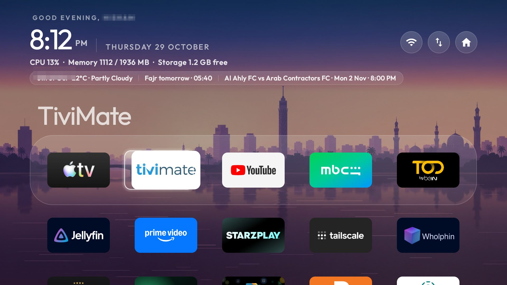

# Cairo on the Nile

A quiet dusk skyline over the Nile: the Cairo Tower, a bridge and a minaret under an open violet
sky, with the water carrying the light back. One picture, no rotation.



## What it changes

| Key | Value | Effect |
|---|---|---|
| `background_color` | `#16122B` | The sky's violet behind everything |
| `wallpaper` | `true` | Show `wallpaper.jpg` |

## Install

```bash
TV_HOST=<tv ip> tools/theme.sh themes/cairo
# Windows
powershell -ExecutionPolicy Bypass -File tools\theme.ps1 -TvHost <tv ip> themes\cairo
```

Undo with `tools/theme.sh --reset`.

## Tested on

Chromecast 4K, launcher 3.2.

## Credit and forks

The picture is the author's own work; see [`CREDITS.md`](CREDITS.md). You may copy, change and
reuse this theme. If you publish a modified version, use a different folder name so people can
tell them apart.
